# Лабораторная работа №6 "Система контроля версий"

## Содержание отчёта 
1. [Цель работы](#цель-работы) 
2. [Порядок выполнения лабораторной работы](#порядок-выполнения-лабораторной-работы) 
3. [Выполнение лабораторной работы](#выполнение-лабораторной-работы)
4. [Лог команд](#лог-команд)
5. [Выводы](#выводы)

## Цель работы 
Изучение базовых возможностей системы управления версиями, опыт работы с Git Api, опыт работы с локальным и удаленным репозиторием.

## Порядок выполнения лабораторной работы 
1. Создать аккаунт на сайте GitHub.
2. Сделать копию в личное хранилище из https://github.com/Kurtyanik/LR6/ (Fork).
3. Установить Git (https://git-scm.com/).
4. После установки настроить клиент git, введя имя пользователя (Группа Фамилия И.О.) и email.
5. Клонировать свой личный удалённый репозиторий на компьютер.
6. Добавить файл через интерфейс GitHub. Подтянуть изменения в локальный репозиторий. Работу продолжать локально.
7. Получить историю операций для каждой из веток.
8. Просмотреть последние изменения.
9. Выполнить слияние в ветку master, разрешив конфликт (можно использовать специальные редакторы или графический интерфейс git).
10. Удалить побочную ветку после успешного слияния.
11. Сделать изменения и зафиксировать их, оставляя комментарии, несколько раз.
12. Сделать откат коммита.
13. Создать ветку для отчёта. 
14. Начать оформлять отчёт в файле README.md (разрешены сторонние редакторы с подсветкой синтаксиса), используя markdown синтаксис (https://guides.github.com/features/mastering-markdown/):
    - В отчёте должен быть снимки экрана консоли и сторонних программ.
Файлы снимков экрана разместить в отдельной папке.
    - Лог команд (без результатов их выполнения).
При написании отчёта периодически делать коммиты, не забывать
комментировать.
15. Получить историю операций в форматированном виде (сокращённый хэш + дата + имя автора + комментарий). Добавить её в отчёт и сделать финальную фиксацию изменений.
16. Отправить локальные изменения в сетевое хранилище GitHub (если делаете работу постепенно, то синхронизацию проводить в конце рабочего сеанса)

## Выполнение лабораторной работы
Для выполнения лабораторной работы был создан аккаунт на платформе Github (рис. 1).
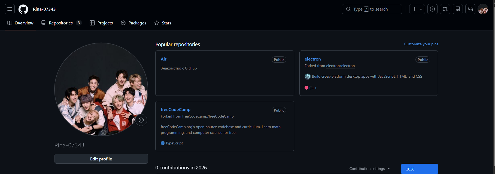

Рисунок 1 – Создание аккаунта на GitHub

Далее перейдя по ссылке  https://github.com/Kurtyanik/LR6/ была сделана копия репозитория в личное хранилище (рис. 2 и рис. 3).
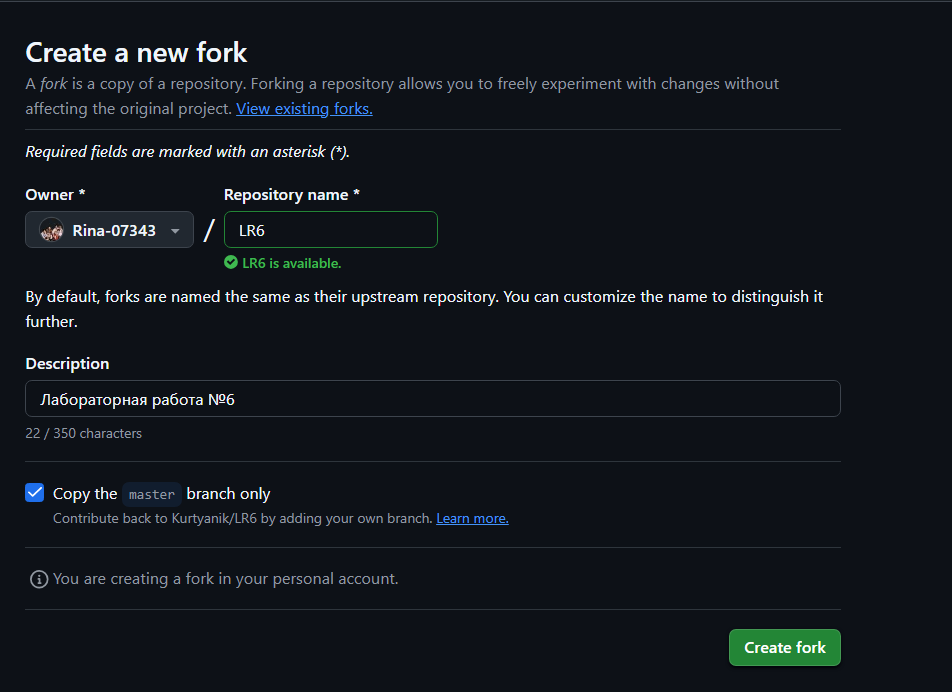

Рисунок 2 – Настройки копирования репозитория

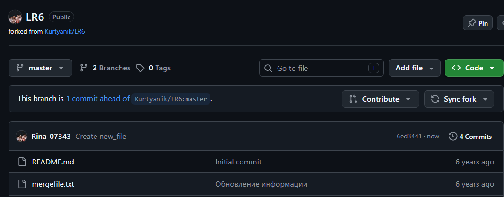

Рисунок 3 – Скопированный репозиторий

Для дальнейшей работы был установлен Git. После установки клиент Git  был настроен, а именно введено имя пользователя (Группа Фамилия И.О.) и email, при помощи команд `git config --global user.name` и `git config --global user.email` (рис. 4).
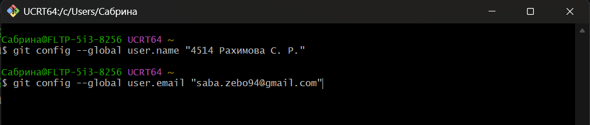 

Рисунок 4 – Настройки имени и почты

Перед клонированием личного репозитория сначала нужно открыть Git Bash в нужной папке далее при помощи команды `git clone` и ссылки на удаленный репозиторий клонировать его на компьютер (рис. 5)
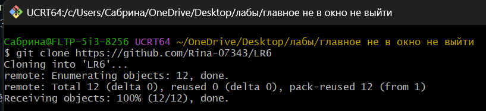 

Рисунок 5 –  Клонирование удалённого репозитория на компьютер

Через интерфейс GitHub был создан файл "new_file"(рис. 6 и 7), который через команду `git pull` был подтянут в локальный репозиторий. Для проверки выполнения команды была использована команда `ls -1`, которая показывает содержание ветки (рис. 8). Далее выполнение последующих пунктов осуществлялось локально.
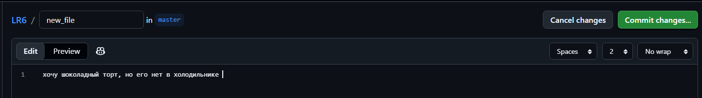 

Рисунок 6 – Создание файла "new_file"
 

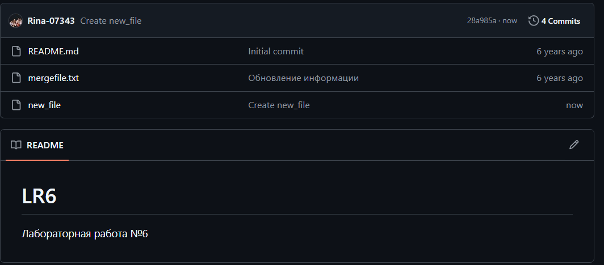 

Рисунок 7 – Созданный файл 

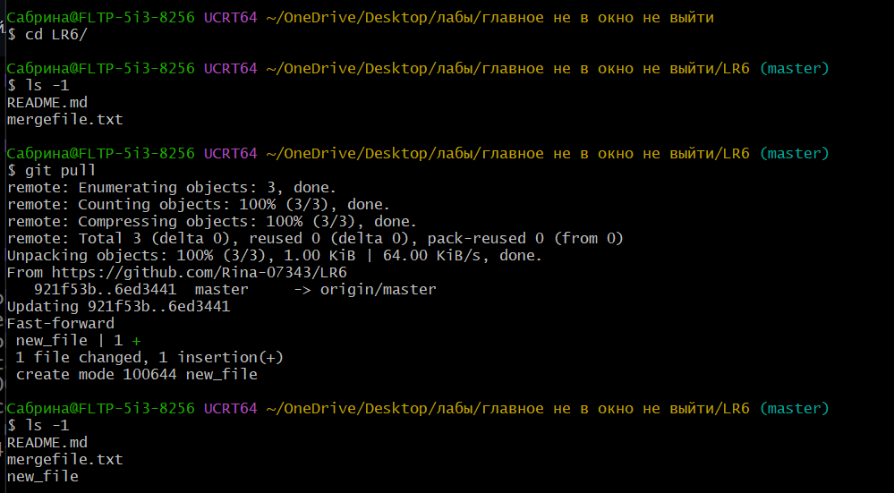 

Рисунок 8 – Установка изменений в локальном репозитории 

Для получения истории операций для каждой из веток была использована команда `git log`. На рисунке 9 представлена история операци для ветки "master". 
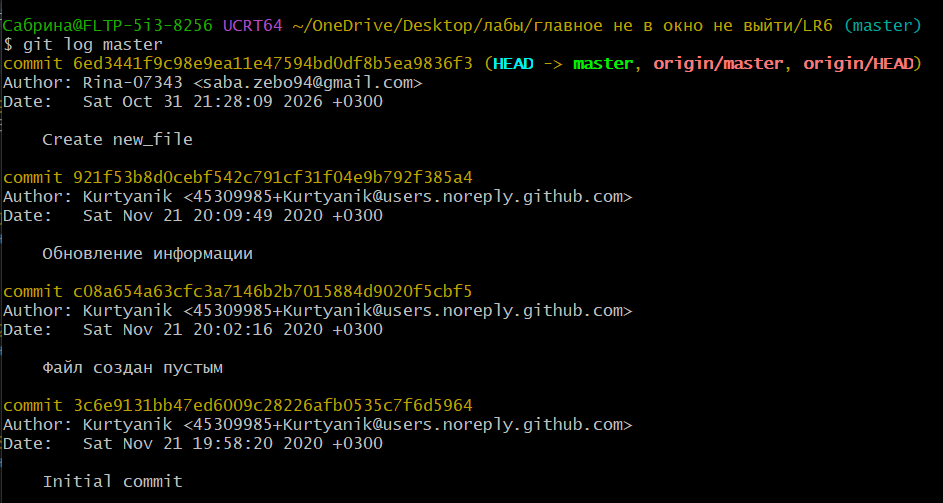 

Рисунок 9 – История операций ветки "master" 

На риснуке 10 представлена история операци для ветки "branch1".
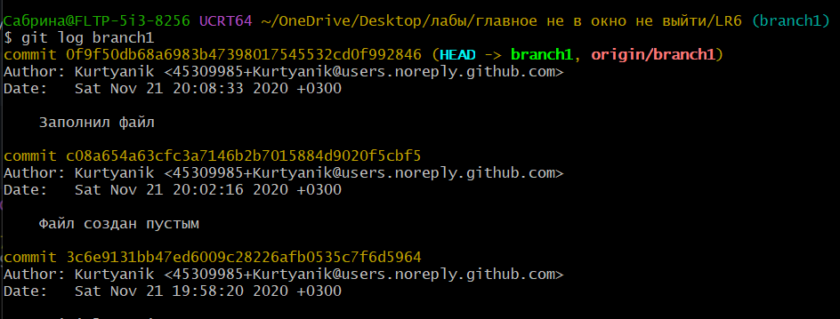 

Рисунок 10 – История операций ветки "branch1" 

Чтобы посмотреть последние изменения была использована команда `git show` для каждой из веток (рис. 11 и 12).
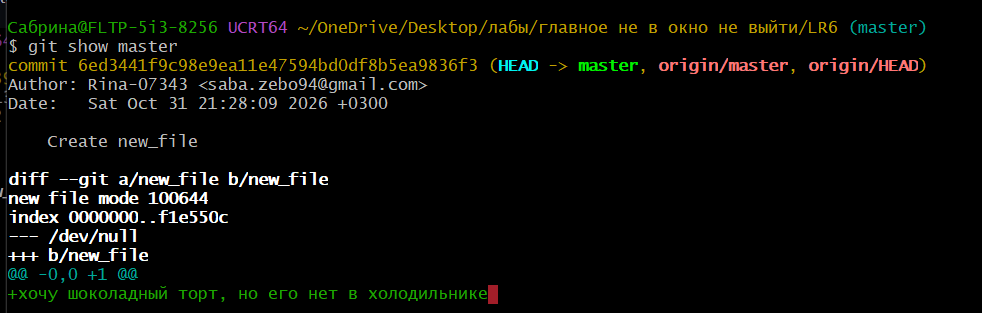 

Рисунок 11 – Последние изменения ветки "master" 

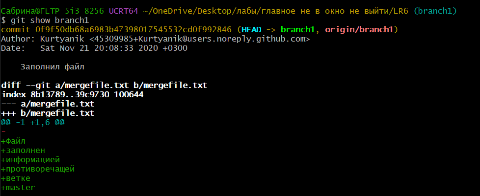 

Рисунок 12 – Последние изменения ветки "branch1" 

Далее было выполнено слияние двух веток. Сначала при помщи команды `git checkout` осуществлен переход на ветку в которую будут слиты файлы из второй ветки. После была применена команда `git merge` для слияния. В результате появился конфликт, т.к. содержание двух одинаковых по названию файлов в ветках имели разное содержание (рис. 13). 
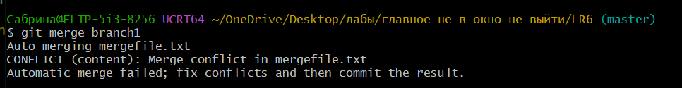

Рисунок 13 –  Появление конфликта при слияние 

Чтобы посмотреть в консоли подробности конфликта была использована команда `git diff` (рис. 14).
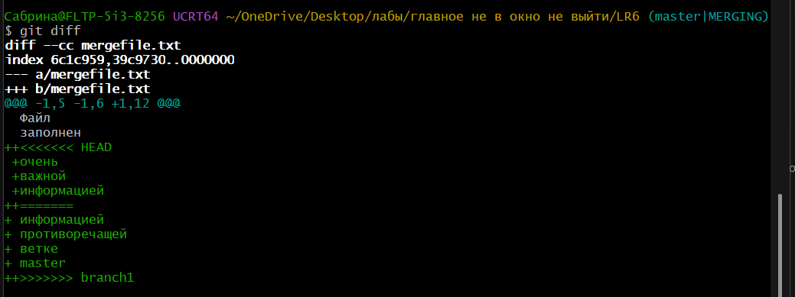 

Рисунок 14 – Конфликт в консоли 

Для разрешения конфликта был использован "VS Code", где был выбран вариант который будет сохранен (рис. 15).
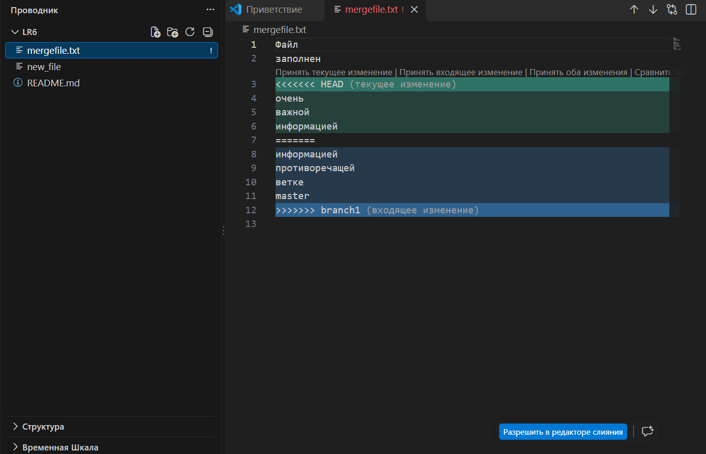 

Рисунок 15 – Разрешение конфликта в "VS Code" 

После разрешения конфликта, полученный файл необходимо зафиксировать. Для этого сначала он добавляется в индекс с помощью команды `git add`.
Затем чтобы проверить что он добавился в индекс используется команда `git status`(рис. 16). И последним шагом фиксируются изменения, чтобы завершить слияние с помощью команды `git commit -m`. 
Чтобы передать все изменения в ветке master в удалённый репозиторий, необходимо воспользоватсья командой `git push`(рис. 17).
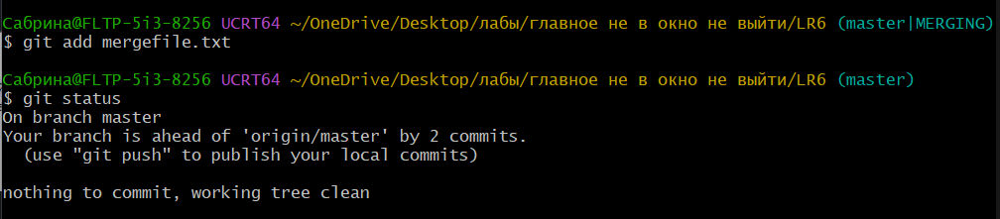 

Рисунок 16 – Добавление полученного файла в индекс 

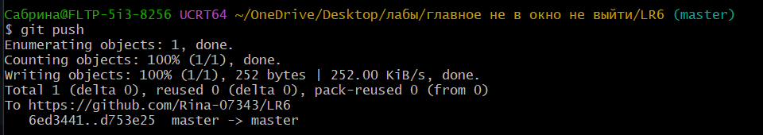 

Рисунок 17 – Обновление удаленного репозитория 

После успешного слияния ветка branch1 больше не нужна и её нужно удалить (рис. 18). Сначала она удаляется локально с помощью команды `git branch -d`. Затем она удаляется из удалённого репозитория `git push origin --delete`.
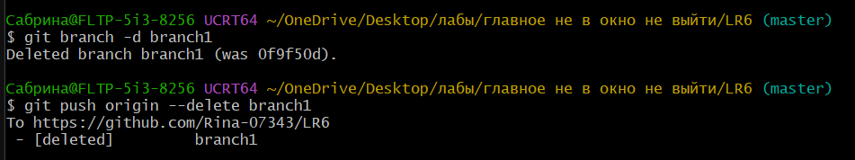 

Рисунок 18 – Удаление ветки "branch1" 

Чтобы создать текстовый файл или сделать изменения в уже существующем файле можно воспользоваться командой `echo "Новый текст файла" > (Название файла).txt`. При помощи данной команды было создано два текстовых файла, которые сохранялись с комментариями.

Создание первого и второго текстового файла с фиксацией изменений репозитория представлены на рисунках 19 и 20 соответственно.
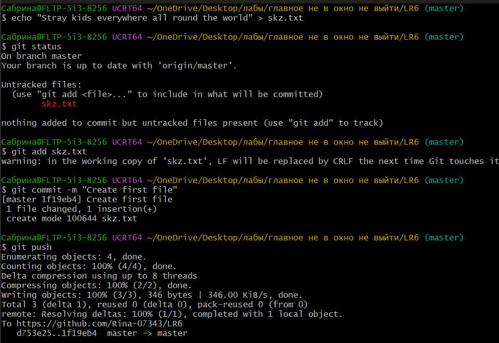 

Рисунок 19 – Создание текстового файла "skz.txt" 

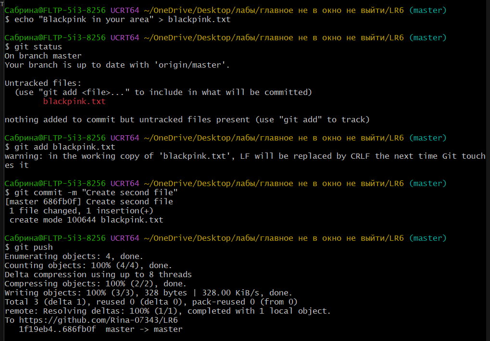 

Рисунок 20 – Создание текстового файла "blackpink.txt" 

Перед откатом коммита необходимо проверить их историю, чтобы после отката можно было убедиться, что всё прошло успешно. Проверить историю можно с помощью команды `git log` (рис. 21).
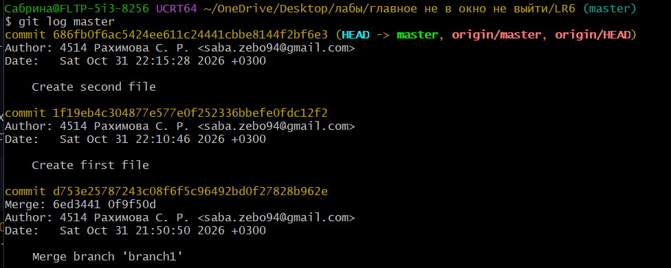 

Рисунок 21 – Проверка истории коммитов 

Для откада последнего коммита необходимо воспользоваться командой `git reset HEAD~1`. 
После отката последнего коммита ещё раз была использвана команда `git log`. До отката последний коммит был "Create second file", а после стал "Create first file",что означает - откат прошёл успешно (рис. 22).
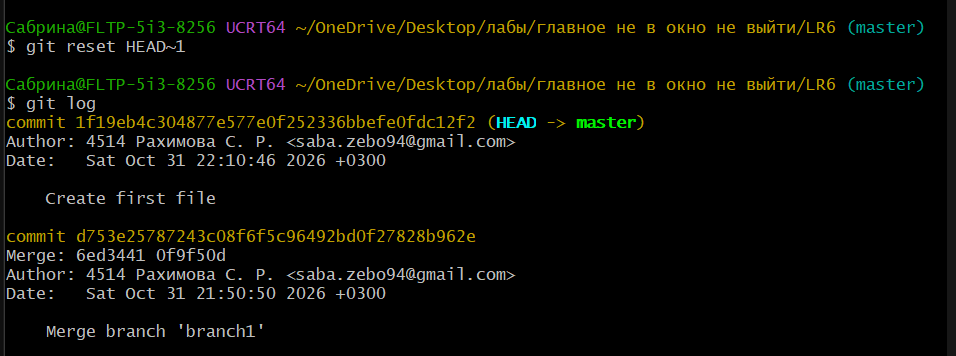 

Рисунок 22 – Откат последнего коммита и проверка истории коммитов 

Для создания ветки для отчёта необходимо воспользоваться командой `git branch`, а чтобы посмотреть какие существуют ветки можно воспользоватсья командой `git branch`. Чтобы недавно созданная локальная ветка "Report" появилась в удаленном репозитории нужно воспользоваться командой `git push origin Report` (рис. 23).
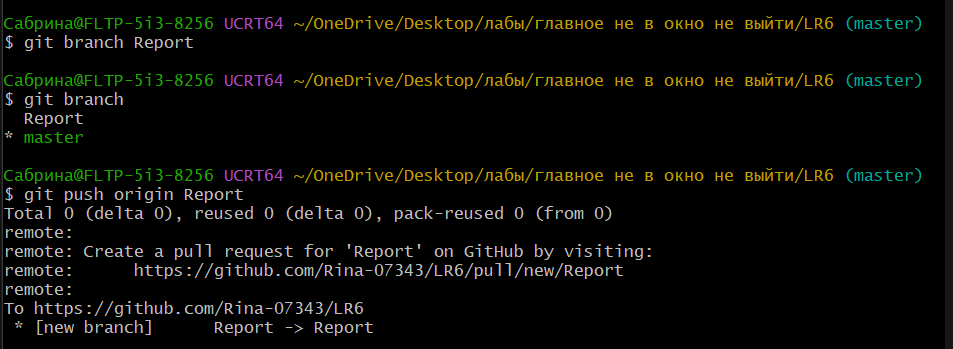 

Рисунок 23 – Создание ветки для отчёта и отправка изменений 

Для написание и удобного форматирования отчёта в файле "README.md" выбран редактор кода VS Code (рис. 24).
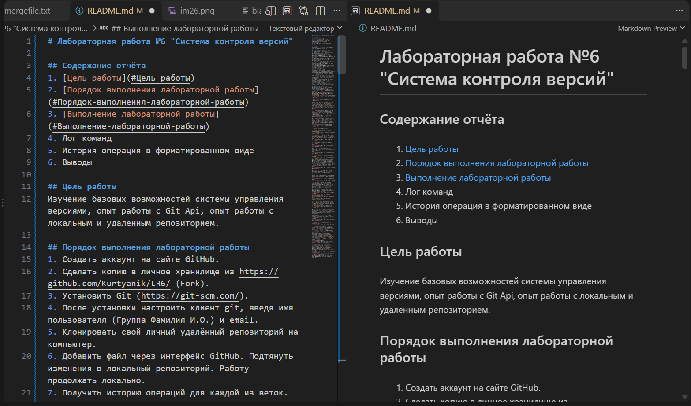 

Рисунок 24 – Написание отчёта в файле "README.md" 

Для получения истории операций в форматированном виде: сокращённый хэш + дата + имя автора + комментарий, была использована команда `git log --date=format:'%D' --pretty=format:"%h -> %cd, %cn ( %s )"`. История операций в форматированном виде представлена на рисунке 25.
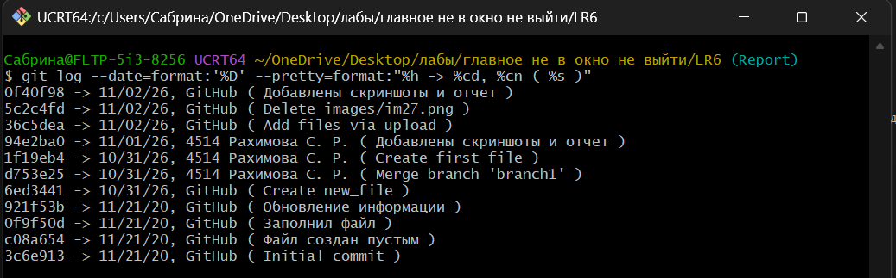 

Рисунок 25 – История операций в форматированном виде 

Чтобы отправить локальные изменения в сетевое хранилище GitHub после завершения написания отчёта была использована команда `git push`. После чего все локальные изменения ветки Report появились в удалённом репозитории.

## Лог команд
git config --global user.name "4514 Рахимова С.Р."   
git config --global user.email "saba.zebo94@gmail.com"   
git clone https://github.com/Kurtyanik/LR6/  
cd LR6/  
ls -1  
git pull  
ls -1  
git log master  
git log branch1  
git show branch1  
git checkout master  
git show master  
git merge branch1  
git diff  
git add mergegile.txt  
git status  
git push  
git branch -d branch1  
git push origin --delete branch1  
echo "Stray kids everywhere all round the world" > skz.txt  
git status  
git add skz.txt  
git commit -m "Create first file"  
git push  
echo "Blackpink in your area" > blackpink.txt  
git status  
git add blackpink.txt  
git commit -m "Create second file"  
git push   
git log master 
git reset HEAD~1  
git log  
git branch Report  
git branch  
git push origin Report  
git pull origin Report  
git log --date=format:'%D' --pretty=format:"%h -> %cd, %cn ( %s )"  
git push origin Report

## Выводы
В ходе выполнения лабораторной рабботы были изучены базовые возможности системы управления версиями, также приобретен опыт работы с Git Api и опыт работы с локальным и удаленным репозиторием. Кроме того был получен практический опыт в использовании основных функций Git, таких как создание и клонирование репозиториев, слияние веток, разрешение конфликтов, а также ведение истории изменений и операций в форматированном виде.